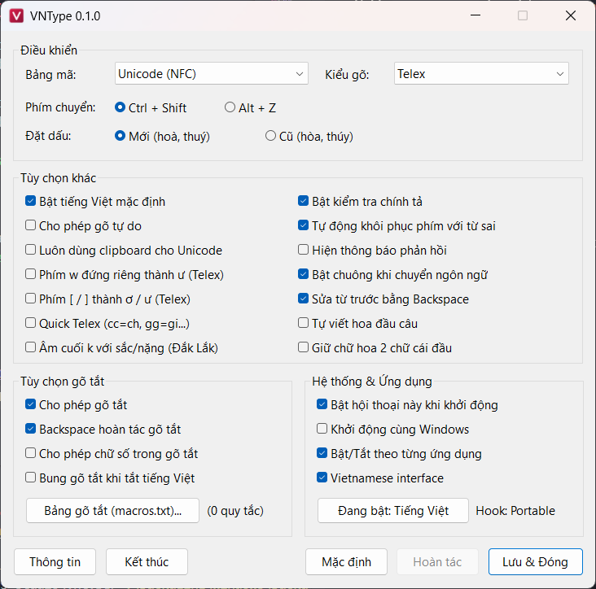
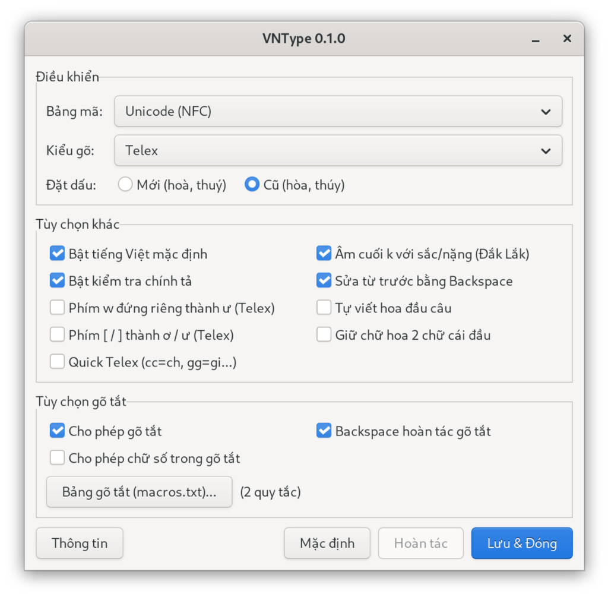

<p align="center">
  
</p>

<h1 align="center">VNType</h1>

<p align="center">
  <strong>Bộ gõ tiếng Việt mã nguồn mở, gọn nhẹ và ổn định cho Linux, Windows và macOS</strong>
</p>

<p align="center">
  <a href="docs/INSTALL.md">Hướng dẫn cài đặt</a> •
  <a href="#tính-năng-chính">Tính năng</a> •
  <a href="#hướng-dẫn-gõ-nhanh">Hướng dẫn gõ</a> •
  <a href="docs/DEVELOPMENT.md">Dành cho lập trình viên</a> •
  <a href="LICENSE">Giấy phép MIT</a>
</p>

---

**VNType** là bộ gõ tiếng Việt mã nguồn mở viết bằng Rust, hướng tới trải nghiệm gõ tự nhiên, nhất quán và tích hợp phù hợp với cơ chế nhập liệu chuẩn của từng hệ điều hành.

## Tính năng chính

- **Hỗ trợ đa nền tảng**:
  - **Linux**: Tích hợp với **IBus** (GNOME, Ubuntu...) và **Fcitx5** (KDE Plasma, XFCE, Hyprland, Sway...). Trên IBus, các tuỳ chọn bộ gõ được đặt trong menu Input Source trên thanh Top Bar.
  - **Windows 10 / 11**: Cung cấp bản **Portable** (`VNType.exe` có thể chạy trực tiếp không cần quyền Admin, kèm biểu tượng khay hệ thống `V/E` và giao diện cài đặt) và bản **TSF** (`vntype_tsf.dll` tích hợp vào thanh ngôn ngữ Windows).
  - **macOS**: Sử dụng **InputMethodKit** (`VNType.app` Universal Binary hỗ trợ cả Apple Silicon `arm64` và Intel `x86_64`).
- **4 kiểu gõ**: **Telex**, **VNI**, **Simple Telex** và **VIQR**.
- **17 bảng mã**:
  - Unicode dựng sẵn (`NFC`), Unicode tổ hợp (`NFD`), TCVN3 (ABC), VNI Windows, VIQR, Vietnamese locale CP 1258.
  - UTF-8 Literal, NCR Decimal, NCR Hex, Unicode C String, X UTF-8.
  - VISCII, VPS, BK HCM 1, BK HCM 2, Vietware X, Vietware F.
- **Xử lý gõ tiếng Việt linh hoạt**:
  - Hỗ trợ quy tắc đặt dấu **Mới** (`oà, uý`) và **Cũ** (`òa, úy`).
  - Kiểm tra chính tả tiếng Việt và giữ nguyên từ tiếng Anh.
  - Hỗ trợ sửa dấu từ trước con trỏ và khôi phục từ khi nhấn `Backspace` xoá dấu cách.
  - Tuỳ chọn `w → ư`, phím `[ ] → ơ, ư`, gõ tắt phụ âm đầu (Quick Telex), viết hoa đầu câu / viết hoa thông minh và bảng gõ tắt (**Macro**).
- **Nhận diện ngữ cảnh nhập liệu**: Tự động chuyển sang tiếng Anh tại các ô nhập mật khẩu và hỗ trợ cấu hình riêng theo từng ứng dụng.

<table align="center">
  <tr>
    <td align="center">
      
      <br />
      <sub><em>Giao diện cài đặt VNType trên Windows (Win32)</em></sub>
    </td>
    <td align="center">
      
      <br />
      <sub><em>Giao diện cài đặt VNType trên Linux (GTK3)</em></sub>
    </td>
  </tr>
</table>

---

## Cài đặt nhanh

> Xem hướng dẫn đầy đủ theo từng bản phân phối Linux và Desktop Environment tại **[docs/INSTALL.md](docs/INSTALL.md)**.

### Linux

- **GNOME / Ubuntu (IBus)**:

  ```bash
  sudo apt install ./vntype-ibus_*.deb
  ibus restart
  ```

  Sau đó mở **Settings → Keyboard → Input Sources → `+` → Vietnamese → VNType**, dùng `Super + Space` để chuyển bộ gõ và bấm vào biểu tượng bộ gõ trên Top Bar để chọn Kiểu gõ, Bảng mã, Kiểu bỏ dấu và các tuỳ chọn.
- **KDE Plasma / XFCE / Hyprland (Fcitx5)**:

  ```bash
  sudo apt install ./vntype-fcitx5_*.deb
  ```

  Mở `fcitx5-configtool` và thêm **VNType** vào danh sách bộ gõ.

### Windows (10 / 11)

- **Bản Portable (khuyên dùng, không cần quyền Admin)**: Giải nén tệp `vntype-*-windows-*-portable.zip` và chạy **`VNType.exe`**. Dùng chuột trái vào khay hệ thống (hoặc `Alt + ,`) để chuyển **V / E**, chuột phải để mở cài đặt.
- **Bản TSF**: Giải nén tệp `vntype-*-windows-*-tsf.zip`, mở PowerShell/CMD với quyền **Administrator** và chạy `regsvr32 vntype_tsf.dll`.

### macOS

- Mở tệp `VNType-*-universal.pkg` để cài đặt, hoặc mở `VNType-*-universal.dmg` và kéo `VNType.app` vào `/Library/Input Methods/`.
- Vào **System Settings → Keyboard → Input Sources → Edit... → `+` → Vietnamese → VNType** để kích hoạt.

---

## Hướng dẫn gõ nhanh

### Bảng phím Telex & VNI cơ bản

| Ký tự / Dấu | Telex | VNI | Ví dụ (`Telex` / `VNI`) |
| --- | --- | --- | --- |
| `â`, `ê`, `ô` | `aa`, `ee`, `oo` | `a6`, `e6`, `o6` | `vieejt` / `vie65t` → `việt` |
| `ă` | `aw` | `a8` | `trawng` / `tra8ng` → `trăng` |
| `ơ`, `ư` | `ow`, `uw` *(hoặc `w`)* | `o7`, `u7` | `nuwowcs` / `nu7o71c` → `nước` |
| `đ` | `dd` | `d9` | `ddi` / `d9i` → `đi` |
| Sắc (`´`) | `s` | `1` | `as` / `a1` → `á` |
| Huyền (`` ` ``) | `f` | `2` | `af` / `a2` → `à` |
| Hỏi (`?`) | `r` | `3` | `ar` / `a3` → `ả` |
| Ngã (`~`) | `x` | `4` | `ax` / `a4` → `ã` |
| Nặng (`.`) | `j` | `5` | `aj` / `a5` → `ạ` |
| Xoá dấu | `z` | `0` | `asz` / `a10` → `a` |

### Phím chuyển bộ gõ Việt / Anh

- **Linux (IBus / Fcitx5)**: Dùng phím tắt chuyển Input Source của hệ thống (`Super + Space` trên GNOME, `Ctrl + Space` trên Fcitx5).
- **Windows**: `Alt + ,` (hoặc click biểu tượng `V` / `E` ở khay hệ thống).
- **macOS**: Dùng phím tắt chuyển Input Source của macOS (`Ctrl + Space` hoặc phím `Globe`/`Fn`).

---

## Tài liệu & Giấy phép

- **Hướng dẫn cài đặt chi tiết**: [docs/INSTALL.md](docs/INSTALL.md)
- **Tài liệu dành cho lập trình viên (build, test, đóng gói)**: [docs/DEVELOPMENT.md](docs/DEVELOPMENT.md)
- **Giấy phép**: Phát hành theo giấy phép [MIT](LICENSE).
